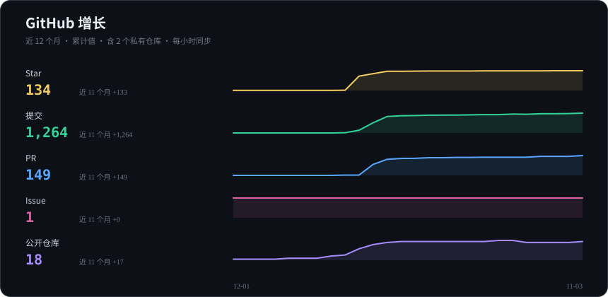

  

  

  &nbsp;
  &nbsp;
  &nbsp;
  

---

## 🧑‍💻 关于我

- 🔭 正在做：**BigFatFish** + **dsh-token-dashboard** + **work-assistant-agent**
- 🌱 正在学：全栈工程化 · Agent 应用
- 💬 专注：全栈开发 · LLM Agent（Python / TypeScript）
- ⚡ 喜欢：读《毛选》、看纪录片、写小说

---

## 🛠️ 技术栈

  

  
  
  
  

  
  
  
  
  
  
  

  
  
  
  
  
  

---

## 🚀 项目

  <a href="#ai-agent">🤖 AI / Agent</a> · <a href="#开发工具">🛠 开发工具</a> · <a href="#web-站点">🌐 Web / 站点</a> · <a href="#基础设施">🛡 基础设施</a> · <a href="#科研与其他">🔬 科研 / 其他</a>

### AI Agent

<table>
<tr>
<td width="50%">💼 <a href="https://github.com/shi-YangYang/work-assistant-agent"><strong>work-assistant-agent</strong></a> <code>Python</code> 把 AI Agent 带进团队日常：管理任务与日报周报，将会议录音转写并整理成结构化纪要</td>
<td width="50%">📱 <a href="https://github.com/shi-YangYang/TapPilot"><strong>TapPilot</strong></a> <code>TypeScript</code> 用 LLM 从电脑操控 Android：读取无障碍树理解界面，USB 与 WSS 双通道，可通过 MCP 接入任意 Agent</td>
</tr>
<tr>
<td width="50%">🐟 <a href="https://github.com/shi-YangYang/BigFatFish"><strong>BigFatFish</strong></a> <code>TypeScript</code> 可长期陪伴、持续积累记忆的 AI 伙伴：覆盖桌面与 Web，也能接入 QQ、B 站与抖音，各入口共享人格与记忆</td>
<td width="50%">📡 <a href="https://github.com/shi-YangYang/AI-Frontier-Radar"><strong>AI-Frontier-Radar</strong></a> <code>TypeScript</code> 本地优先的 AI 前沿资讯雷达：聚合 X 账号、官方博客与 RSS，支持多渠道推送并内置本地控制台</td>
</tr>
<tr>
<td width="50%">🔬 <a href="https://github.com/shi-YangYang/openlab"><strong>openlab</strong></a> <code>Python</code> 开源科研 Agent 框架：把文献挖掘、假设生成、实验设计与论文写作连成一条完整流程</td>
<td width="50%">🧭 <a href="https://github.com/shi-YangYang/jobpilot-agent"><strong>jobpilot-agent</strong></a> <code>TypeScript</code> 可解释的 AI 求职助手：岗位分析、人岗匹配、投递跟踪与面试准备</td>
</tr>
<tr>
<td width="50%">📊 <a href="https://github.com/shi-YangYang/dsh-token-dashboard"><strong>dsh-token-dashboard</strong></a> <code>TypeScript</code> DeepSeek Harness 用量看板：汇总跨会话与子代理的 Token 消耗、费用与请求延迟，并呈现历史趋势</td>
<td width="50%"></td>
</tr>
</table>

### 开发工具

<table>
<tr>
<td width="50%">🗣️ <a href="https://github.com/shi-YangYang/opencode-speak-freely"><strong>opencode-speak-freely</strong></a> <code>Python</code> 为 OpenCode 补足代码上下文、拆分多阶段流程，并自动修复被拒请求，内置本地 Web UI</td>
<td width="50%">🎨 <a href="https://github.com/shi-YangYang/ai-interface-studio"><strong>ai-interface-studio</strong></a> 面向 Codex 的界面设计 Skill：将产品想法转化为 UI/UX 方案、页面设计图与可交互的前端预览</td>
</tr>
<tr>
<td width="50%">🛠️ <a href="https://github.com/shi-YangYang/utility-site"><strong>utility-site</strong></a> <code>JavaScript</code> 工具站点合集：每个小工具拥有独立的目录、依赖与构建，互不影响</td>
<td width="50%">🔗 <a href="https://github.com/shi-YangYang/plus-extractor"><strong>plus-extractor</strong></a> <code>JavaScript</code> 浏览器扩展配合本地中继，一键提取 Plus 直卡链接，支持 Chrome 与 Edge</td>
</tr>
</table>

### Web 站点

<table>
<tr>
<td width="50%">🌐 <a href="https://github.com/shi-YangYang/personal-site"><strong>personal-site</strong></a> <code>JavaScript</code> 自托管双语个人站：包含博客、终端与站内 Agent，基于 Next.js 与 FastAPI，以单个容器部署</td>
<td width="50%">📘 <a href="https://github.com/shi-YangYang/LittleBlueBook-Web"><strong>LittleBlueBook-Web</strong></a> <code>TypeScript</code> 「小蓝书」社区全栈实现：Next.js 搭配 PostgreSQL 与 Redis，Docker 一键启动</td>
</tr>
</table>

### 基础设施

<table>
<tr>
<td width="50%">🛡️ <a href="https://github.com/shi-YangYang/VergeN"><strong>VergeN</strong></a> <code>Rust</code> 企业 VPN 客户端与运维面板：桌面端采用 Tauri 与 Rust，配套 Android 客户端与 Go 服务端，自动构建出包</td>
<td width="50%">🌀 <a href="https://github.com/shi-YangYang/HRX-FanControl"><strong>HRX-FanControl</strong></a> <code>Python</code> 联想 ThinkSystem 服务器的温度监控与五级风扇控制：终端查看温度与转速，可在自动与手动档位间切换</td>
</tr>
</table>

### 科研与其他

<table>
<tr>
<td width="50%">🧠 <a href="https://github.com/shi-YangYang/malecns_lab"><strong>malecns_lab</strong></a> <code>Python</code> 基于 MaleCNS 果蝇连接组的研究平台：训练脉冲神经网络，观察神经活动并开展具身控制实验</td>
<td width="50%">🎓 <a href="https://github.com/shi-YangYang/Student-System"><strong>Student-System</strong></a> <code>Python</code> 课程设计项目：基于 Python 与 MySQL 的学生管理系统</td>
</tr>
</table>

## 📊 GitHub 数据

  

<!--
Ÿ HŸPE 隐身访客像素（可选）：登录 yhype.me 后把下面这行替换为你的像素 URL 并取消注释

-->

---

## 🐍 贪吃蛇

  <picture>
    <source media="(prefers-color-scheme: dark)" srcset="https://raw.githubusercontent.com/shi-YangYang/shi-YangYang/output/github-snake-dark.svg" />
    <source media="(prefers-color-scheme: light)" srcset="https://raw.githubusercontent.com/shi-YangYang/shi-YangYang/output/github-snake.svg" />
    
  </picture>

---

## 一些随笔

- 一万年太久，只争朝夕
- 坚持阶级斗争

---

## 📫 联系我

  
  
  
  

   
  

  

